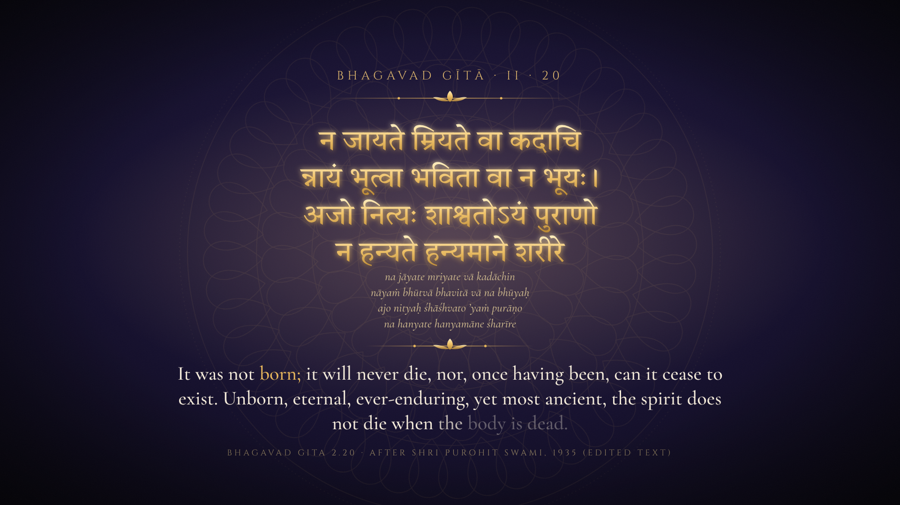
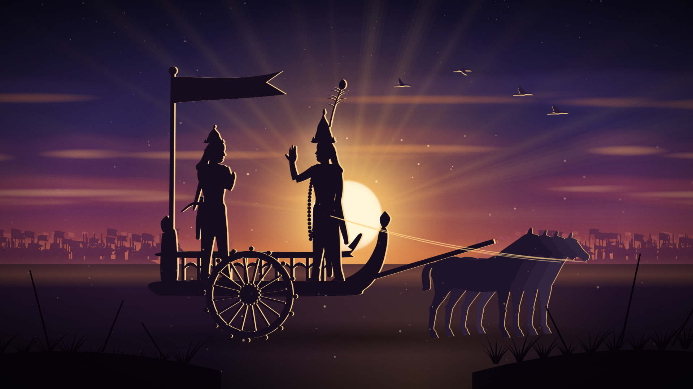
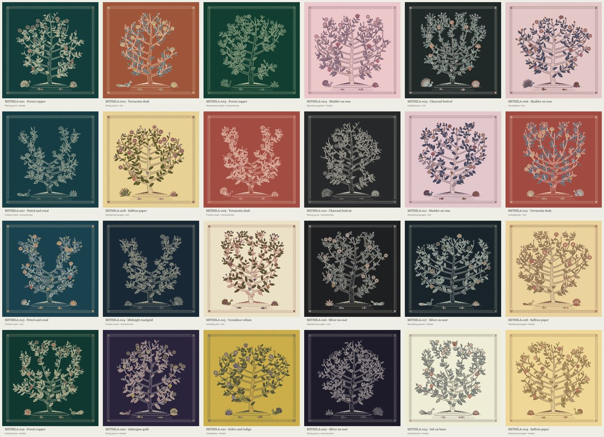

# Style research: what GitHub offers the spiritual channel

21 October 2026. AK asked for a style search on GitHub after the flat, outlined illustration kit was rejected twice as looking like a "2nd grade drawing". Only sources with commercial licences count.

## The short answer

- **Main look: Lamplight.** Every figure is a flat, near-black silhouette with a thin gold rim on the side that faces the light. Light is the only colour: dawn skies, a diya, god rays and dust. The Katha kit built for the Gita film already uses this look. Its stage, skies, dust, haze, rim-lit silhouettes, grain and verse and title cards exist. Its metaphor scenes are still empty.
- **Why it comes first.** It is the only one of the four looks that meets rule 5 of the channel plan for the Gita film, which shows Krishna only as a backlit silhouette. Five of the six research angles proposed a backlit-silhouette or shadow-theatre look on their own.
- **What makes it ours.** Backlit silhouettes are a familiar look in faceless philosophy and devotional content, though the research could not watch videos to measure how common. Indian details set it apart: the diya as the signature light, shadow-puppet perforations on close-ups, Devanagari verse cards, kolam lines, and Mithila ornament on titles and trees.
- **The alternative.** Mithila fine-line art on dark grounds is the most distinctive option and the least like clip-art. It is slower, because the chariot, horses and people do not exist in that style yet and must be designed.
- **Not as the main look.** Ink wash reads as Chinese or Japanese unless every form is redrawn, and its painted plates are slow to render. Toon 3D slides toward a mobile-game look and renders slowly on a CPU. Animated museum paintings bring faces and deities.
- **One problem to fix first.** The horses and birds already in the Katha kit come from non-commercial models. The section below explains this and the fix.

The art director's full write-up of each direction, with scene recipes, build steps and a one-sitting prototype brief, is in [style-research/DIRECTIONS.md](style-research/DIRECTIONS.md).

## Licence problem in what we already built

The horse and bird silhouettes in the Katha kit are not safe for a monetised channel.

**Resolved, 21 to 22 Oct.** AK approved the fix and chose Lamplight. The horses are re-traced from the CC0 Quaternius horse, the birds are drawn in code, and `build_film.py` checks every silhouette's credit on each build (`src/katha/sil/LICENSES.md`). The film's state is in `docs/katha/GITA_FILM.md`.

- **What happened.** They were traced from the horse, flamingo, stork and parrot models that ship in the three.js repository. Those models come from *3 Dreams of Black* (ro.me). That repository's README says it "has been opened up with the Apache License 2.0", and I relied on that line. The models folder carries its own licence file, and it reads: "3D assets and textures ... are licensed under a Creative Commons Attribution-NonCommercial-ShareAlike 3.0 Unported License".
- **Who confirmed it.** I read that file myself. Two research checkers reached the same verdict on their own, the 3D checker and the illustration-library checker.
- **What it touches.** The traced frames in `src/katha/sil/` feed the chariot team, the standing horses and the flocks of birds. Nothing has been published.
- **What changed today.** The false "Apache" claims are corrected in the code comments, the kit guide, the channel plan and the traced files. The film build now prints a BLOCKER warning at the end of every build until `NC_SILHOUETTES` is set to False in `scripts/katha/build_film.py`. It is a warning only and does not stop the build or a render.
- **The fix.** Re-trace the horse from the CC0 Quaternius horse described in the 3D table further down. A research probe already loaded it and played its gallop in our container, so the model is usable. Turning it into silhouettes needs new tracing code, because the current tracer handles only a simpler kind of animated model. Birds need a CC0 source too. Flapping birds are simple enough to build in code, and PhyloPic has CC0 bird silhouettes for still shots. This work waits for the owner's go-ahead, which is question 1 below.

## The four directions, ranked

| Rank | Direction | Effort | Main risk |
|---|---|---|---|
| 1 | Lamplight: backlit silhouettes with a gold rim | Low to medium. The kit exists; replacing horses and birds takes 2 to 3 days. | A generic look without the Indian details. |
| 2 | Mithila fine-line: heritage textile line art on dark grounds | Medium to high. Each new subject is a day or more of design. | Chariot, horses and people must be invented in the style. |
| 3 | Ink and lamplight wash on warm paper | High. Plates are painted offline, then the camera and light move. | Reads as Chinese or Zen unless re-skinned. Slow. |
| 4 | Lamplit clay diorama in toon-shaded 3D | High. Every Indian prop is modelled in code. | Mobile-game look. CPU render of 1.5 to 3 hours per 10 minutes. |

### 1. Lamplight, the recommended bet

- **Why it fits.** Light against darkness is the texts' own image: the lamp of knowledge, the rope taken for a snake in dim light. Silhouettes are faceless by nature. They hide interior drawing, which is what made the old kit look childish, and they rely on gradients, timing and code, which we do well. High contrast also reads well on a phone, which suits Shorts.
- **Scene recipes.**
  - *Chariot of the self:* four CC0 horses walking out of step, since the Gita's chariot has four white horses and the kit already draws four, and two faceless figures, all one rim-lit silhouette, crossing a ridge at dawn in a seamless 12-second loop.
  - *Two birds on one tree:* one tree against a full moon. The lower bird pecks a fruit. The upper bird sits still with a brighter rim and watches.
  - *Inverted tree:* a procedural tree turned upside down, hanging from a real star field, with dawn rising from below.
  - *Rope and snake:* one diya in a dark room. A coiled rope casts a wall shadow that reads as a cobra while the flame is low. A second lamp is lit and the shadow becomes rope again.
  - *Salt in water:* a glass bowl backlit by a low sun. The salt shrinks while gold specks spread, until the whole bowl glows evenly.
  - *Three gunas:* one seated figure lit from three sides by white-gold, flickering saffron and a dim indigo ember. The rim colour follows the guna the narration names.
  - *Verse card:* the kit's existing card, gold Devanagari over a dark sky, with one kolam line drawing itself faintly behind.
  - *Chapter title:* darkness, then one diya is lit, and a gold kolam line draws around the Devanagari numeral.
- **Next step.** Build the 12-second chariot loop from the CC0 horse and mannequin as a test. The brief in the directions file names every file, package version and licence, and says when the test is done. The research probe's code is kept as a starting point in [style-research/probe/Probe.tsx.txt](style-research/probe/Probe.tsx.txt).
- **The director's notes on the current Gita frames.** The chariot frame is busy for a calm channel, with armies, spears and flags. The traced team "moves like a comb". Keep the armies for Kurukshetra beats only and strip them from Upanishad scenes.

### 2. Mithila fine-line

Cream, ochre and vermilion hairlines on forest, indigo or soot grounds, with a double contour and a hatched channel between the lines. Leaves repeat by the hundred and a block-print border frames each scene. People are solid profile shapes with no features. Rule 5 allows Krishna and Arjuna only as backlit silhouettes, so a Mithila Gita film would still need Lamplight shots for Krishna. Mithila suits the Upanishad films and the ornament layer best. The MIT-licensed `starphazed/mithila-tree-of-life` generator already makes museum-quality trees with two perches for birds. It can be flipped into the inverted tree and also makes borders.

*Seed contact sheet from starphazed/mithila-tree-of-life, MIT License, Copyright (c) 2026 starphazed.*

### 3. Ink and lamplight wash

Warm paper, lamp-black ink in five tones, tapered brush lines and soft washes with a lot of empty paper. There is one warm accent per scene, such as the diya flame or a saffron pennant. India has its own lineage for this look in the Bengal School wash of Abanindranath Tagore and Nandalal Bose. Every ink library defaults to pines, pavilions and seals, though, so each motif needs Indian forms. Brush painting is too slow to repaint every frame without a GPU, so plates are baked and then animated by camera and light.

### 4. Lamplit clay diorama in 3D

A small, quiet world like a stop-motion set, with matte toon shading and fog. It gives the most convincing motion and real parallax. The research probe looked like a mobile-game prototype, and every Indian prop must be modelled in code. **Its best use is as the motion source for direction 1, not as the visible style.**

## Toolbox: verified sources by job

A second agent checked every row's licence, from the licence file in the repository or package where there is one, and tested the download from our container. A few small packages declare their licence only in package.json: @remotion/noise, @remotion/motion-blur and @gltf-transform/cli. Cinzel was checked only through npm, and its OFL text is already in `public/fonts/katha`. On-screen credit is optional unless the row says otherwise. Code we copy or port keeps its licence notice in our source tree.

### Type, verse cards and ornament

| Source | Licence | Use |
|---|---|---|
| Tiro Devanagari Sanskrit and Hindi (`@fontsource/tiro-devanagari-*`) | OFL 1.1 | Verse cards. The Sanskrit cut is already in the kit. It has no bold, so bold Hindi titles can use the Noto Serif Devanagari already in `public/fonts/`, a variable font up to weight 900. |
| Noto Serif Devanagari, Annapurna SIL, Shobhika, Rozha One, Eczar, Gotu (Fontsource or upstream) | OFL 1.1 | Weight contrast, Vedic accents (Shobhika), display titles. |
| Cormorant Garamond, EB Garamond, Cinzel (Fontsource) | OFL 1.1 | English lines and titles. |
| Tegaki (`gkurt/tegaki`, npm `tegaki`) | MIT. Bundled fonts are OFL except Hershey Script, which has its own permissive terms. | Devanagari written stroke by stroke and correctly shaped. The stroke order is guessed, not traditional, and no Devanagari bundle has been built yet; its generator needs Bun. Test one verse before relying on it. |
| harfbuzzjs | MIT | Shapes Devanagari conjuncts if we brush-reveal glyph outlines ourselves. |
| Muggula Prastaram (`@muggula-prastaram/core`, `/render`) | MIT | Kolam patterns drawn as one unbroken line. Title cards, borders, transitions. |
| Kolam-Maker (`evoluteur/kolam-maker`) | MIT | Borrow its rice-powder texture and earth palettes. Not the app code. |
| Mithila Tree of Life (`starphazed/mithila-tree-of-life`) | MIT | Seeded Madhubani-style tree for verse borders and title cards. No figures in it. |

### Ink, paint, paper and morphing

| Source | Licence | Use |
|---|---|---|
| sumi (`tengubyte/sumi`), vendored from tag v0.12.0 | MIT for `src/` only | Ink brush, ink wash and ink-bloom transitions. Not on npm. Its showcase art and KanjiVG files are not licensed to us. WebGL, so test speed on the Mini first. |
| perfect-freehand | MIT | Tapered, pressure-shaped strokes. The cheapest cure for uniform marker outlines. |
| p5.brush (standalone build) | MIT | Watercolour and charcoal plates painted offline with a seed. npm installs its p5 peer dependency (LGPL 2.1), but the standalone build never loads it. |
| Watercolorizer (`@watercolorizer/watercolorizer`) | ISC | Layered-polygon watercolour washes. |
| spectral.js | MIT | Mixes colours like real pigment. |
| flubber | MIT | Shape morphs: rope into snake, salt into water. |
| {Shan, Shui}* and Nonflowers (LingDong-) | MIT | Technique sources for ink ridges, mist and petal shading. Port ideas, and replace their p5-derived noise. |
| Paper.js with paperjs-offset; d3-delaunay | MIT; ISC | Cut-paper layers and stained-glass or mosaic cells. |
| riso-colors, @thi.ng/color-palettes | MIT; Apache 2.0 | Tested palettes. |

### Light, grain and sky

| Source | Licence | Use |
|---|---|---|
| Paper Shaders (`@paper-design/shaders-react`), pinned to 0.0.82 | Apache 2.0 from 0.0.77 only | God rays, grain gradient, paper texture, water. Skip its perlin, voronoi and neuro-noise shaders, which have outside origins. |
| @remotion/noise, @remotion/paths, @remotion/shapes, @remotion/motion-blur | MIT | Seeded noise, stroke reveals, motion blur. |
| MIT shader blocks: webgl-noise (stegu), glsl-film-grain, glsl-godrays, glsl-halftone; pixi-filters source | MIT | Replace LYGIA, which is non-commercial. |
| d3-celestial star catalogue | BSD-3 | A real night sky. Skip its Milky Way file. Credit in the description: "Star data: d3-celestial (c) 2015 Olaf Frohn, BSD-3-Clause". |
| natural-earth-vector | Public domain | Maps of India's rivers and pilgrimage routes. For any national border, use India's point-of-view file `geojson/ne_10m_admin_0_countries_ind.geojson` or draw no borders. The default world files show de facto borders that differ from India's official map. |

### 3D route (`@remotion/three`)

| Source | Licence | Use |
|---|---|---|
| Quaternius horse, repacked in `stepanMiller/wild-mustang` (`public/assets/characters/horse.glb`) | CC0 1.0 (Quaternius) | **The replacement horse.** The repo adds a Trot clip and a face blaze (material Veter_Blaze). Its asset register lists them as CC0, but the repo itself is MIT, so use Walk or Gallop and hide the blaze to stay pure CC0, or keep the MIT notice beside the file. Rigged, with idle, walk and gallop. Trace it to silhouettes, or render it lit. |
| Quaternius Universal Animation Library 1 and 2 (`J-Ponzo/gltf-universal-animation-library`, `tilakpatell/tilakverse-assets`) | CC0 | Faceless mannequins with sitting, driving, bow and lantern clips. A source for Arjuna and Krishna poses. From tilakverse-assets, take only the `quaternius/` folders: its `sketchfab/star-wars/` models are CC BY or CC BY-NC-SA. |
| Quaternius Stylized Nature MegaKit (`tilakpatell/tilakverse-assets`) | CC0 | Trees and ground cover for backgrounds. Take only the `quaternius/` folders, as above. |
| EZ-Tree (`@dgreenheck/ez-tree`) | MIT | Procedural trees, including the inverted ashvattha. Replace its bundled textures. |
| @react-three/fiber, three, @react-three/drei | MIT | Render path. Do not use drei Text for Devanagari. |
| postprocessing, @react-three/postprocessing, n8ao, three-good-godrays | zlib, MIT, CC0, zlib | Bloom, grain, vignette, ambient occlusion, light shafts. |
| @pmndrs/assets, HDRIs only | CC0 | Environment light. Its matcaps have unknown authors, so skip them. |
| webgl-outlines (`OmarShehata/webgl-outlines`), three-custom-shader-material, @takram/three-atmosphere | MIT | Ink outlines, painterly ramps, real sky scattering. |
| @gltf-transform/cli | MIT | Cuts the 21 MB animation libraries down to the clips we use. |

### Real art from museums (CC0)

| Source | Use |
|---|---|
| The Met Open Access images in the Google Cloud bucket `gcs-public-data--met`, indexed by `metmuseum/openaccess` | The strongest pool. Filter every ID on "Is Public Domain". The bucket is a 2017 copy, so recheck IDs against the current index. |
| Smithsonian Open Access on AWS: Freer and Sackler Indian paintings, and Cooper Hewitt's Daniell aquatints of India | High resolution. Check each item's own CC0 flag, not the GitHub repo. |
| The Met's 19th-century photographs of India, such as Tripe, Murray and the Benares ghats | Archival B-roll. Avoid cremation and 1857 sites. |
| Palm-leaf manuscript folios at the Met | Text-only grounds for verse cards. |
| Met lotus and water paintings | Lotus beats. They are Chinese and Japanese works, so crop the inscriptions. |
| Biodiversity Heritage Library bucket `bhl-open-data`, such as Roxburgh's *Plants of the Coast of Coromandel* and Jerdon's *Birds of India* | Museum-grade botanical and bird plates. Each item has its own licence, and about 38,000 items are CC BY-NC-SA. Use only items whose record says public domain or not in copyright. |

Most Indian miniatures of the Gita show Krishna with a face and in colour, and many show other deities. Rule 5 allows Krishna only as our own faceless silhouette and no other deity, so those paintings stay out. Question 5 below covers only paintings of people who are not deities.

### Build-time tools

| Source | Licence | Use |
|---|---|---|
| rembg | MIT | Cut out museum figures. **Always name the model: `-m u2net` or `-m birefnet-general` on the command line, `new_session("u2net")` from Python.** The default model, bria-rmbg, is not licensed for commercial use. Avoid isnet-general-use too, because its training set is non-commercial and its weights carry no licence. |
| MiDaS | MIT | Depth maps for gentle 2.5D moves on still plates. |
| sharp | Apache 2.0 | Crop and grade. Its libvips binary is LGPL and is used only as a tool. |

### Small symbols, as accents only

Tabler, Lucide and Phosphor icons (MIT or ISC), Material Symbols (Apache 2.0), Noto Emoji monochrome (OFL), Font Awesome Free icons (CC BY 4.0, so credit them), lindenmayer (MIT) and PhyloPic silhouettes (per image: use only CC0, public-domain mark, or CC BY with credit).

## Dropped, and why

- **Non-commercial or share-alike licences.** The three.js example animals (CC BY-NC-SA), the LYGIA shader library (Prosperity licence), mixbox (non-commercial), OpenMoji (CC BY-SA), the Sri Yantra triangle data (CC BY-SA), and rembg's default model.
- **Strong copyleft.** DepthFlow is AGPL, so it is a design reference only.
- **No licence at all.** Many Indian-art repos look good but carry no licence: Pahari Scroll, KALA, the Sanatan Dravidian temple (temple-3d), Vimana Grammar, Scrawl, Fourier Border Studio, Inkblade. All rights are reserved, so we copy nothing.
- **Laundered assets.** `@yantrakit/vedic-icons` says MIT, but its own credits show most designs come from Flaticon.
- **Not needed.** `@remotion/effects` is under the Remotion licence and its canvas effect needs a newer Chrome than ours. Gradients and baked textures cover the same looks.
- **Main look, no; supporting layer, yes.** Sacred geometry and kolam alone turn into a screensaver, so they stay as cards and transitions. Museum paintings carry faces and deities, so they stay as occasional B-roll. Sanjhi cut-paper is deferred, since its traditional repertoire is Krishna-lila and it overlaps with Mithila.
- **Wrong look.** Emoji sets, Open Peeps, unDraw, Kenney and KayKit kits, Polygonal Mind models, Rough.js, and Victorian ornament sets. Each pushes toward the clip-art look the owner rejected, or toward a game look.
- **Unreachable.** Wikimedia, the British Library, the Internet Archive, Cleveland and Chicago images, and most museum image servers are blocked from our container. The owner could download from them on the Mini.

## Questions only the owner can answer

**Already settled, so not asked.** Rule 5 in the channel plan, set after your request for the Gita as Krishna told it to Arjuna, lets Krishna appear as a faceless backlit silhouette known by crown, peacock feather and garland, with his cosmic form only as light. The art director worked from the older no-deity rule, so its notes about Krishna's figure do not apply. The Gita film keeps the current figure. In Katha Upanishad scenes the driver stays unmarked, because there he stands for the intellect.

1. **Go-ahead for the licence fix.** The horses and birds in the Katha kit must be replaced before anything is published, whichever look you pick. May I replace them now with the CC0 Quaternius horse and CC0 or code-drawn birds? It takes 2 to 3 days, including the new tracing code.
2. **The main look.** Lamplight, a familiar look but the only one that meets rule 5 for Krishna? Or the more distinctive Mithila fine-line, keeping Lamplight for Krishna's scenes? A side-by-side of the same 12-second chariot loop can settle it. The Lamplight test takes one sitting. The Mithila test needs about 3 more days, for the generator, the pose tracer and a new line renderer.
3. **Explainers too.** The kit you rejected draws the explainer videos, including the Gita chapter 2 pilot. Should they move to the new look, reusing the Katha kit's skies, silhouettes and verse cards? Or is the new look for the story films only?
4. **One look or two.** Lamplight for story beats plus Mithila ornament for trees, titles and borders, sharing one indigo-and-gold palette? Or one look for the Gita and another for the Upanishads?
5. **Museum art.** Are real historical paintings acceptable as occasional B-roll when they show human, non-deity faces? The faceless rule was written for our own figures. Are colonial-era aquatints acceptable for temple and river shots?
6. **Cultural framing.** Is "inspired by Mithila painting" acceptable on screen and in descriptions? Or should a living Mithila artist review the textile direction, or be paid to advise?
7. **Chariot staging.** The kit seats Krishna at the front while the chariot moves and stands him while he teaches. Arjuna always stands. Keep that, or seat the rider too, as in the CC0 sitting motion?
8. **Remotion licence.** Remotion is free for individuals and for companies of up to 3 people. Above that, a paid company licence is needed. Which applies to the channel?
9. **Render budget.** A 3D look costs 1.5 to 3 hours of CPU render per 10 minutes of video. Is that acceptable, or will renders run on a GPU machine such as the Mini? This matters only for direction 4.
10. **Symbols.** Are Om, the dharmachakra or yantras welcome on screen? Or should sacred geometry stay with kolam lines and lotus rings?
11. **Shorts.** Should Shorts use the main look, or always the high-contrast Lamplight mode for phone screens?

## How the search ran

Six research agents searched from six angles. The angles were Indian art styles, illustration libraries, painterly rendering, 3D, public-domain museum art, and the styles of successful channels. Each angle then went to a second agent told to refute every licence claim. That agent read the licence file in the repository or package, tested the download from our container, and added sources the searcher had missed. An art-director agent then turned the verified results into the ranked directions above.

| Measure | Count |
|---|---|
| Candidates checked | 110 |
| Kept after checking, counting a source once per angle | 63 |
| Extra sources found and checked by the verifiers | 24 |

The full list with licence quotes and reachability notes is in [style-research/VERIFIED_SOURCES.md](style-research/VERIFIED_SOURCES.md).
